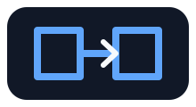

<p align="center"></p>
<p align="center"></p>
<p align="center"><a href="LICENSE"></a>   </p>
<p align="center"></p>

## 🧭 Overview
See cancellation, deadlines, and timeouts propagate from a parent context to worker goroutines. The examples use the Go standard library and short, bounded demonstrations.

## ✨ Features
- 🛑 Compare explicit cancellation, absolute deadlines, and relative timeouts
- 🧵 Watch multiple workers stop when their context is done
- 🧭 Inspect context errors and parent-to-child cancellation

## 🎬 Demo
Run the CLI and compare the printed event order and context/channel state. No hosted demo is claimed.

## 🚀 Quick Start
```bash
go run .
```
Use `go run . -scenario cancel`, `-scenario deadline`, `-scenario timeout`, or `-scenario all`.

## 🧰 Tech Stack
- 🧩 Go standard library
- 🔒 No network access or external services
- 📦 No third-party dependencies

## 🗂️ Folder Structure
```text
go-context-cancel-lab/
├── assets/mark.svg
├── main.go
├── main_test.go
├── go.mod
├── .gitignore
├── LICENSE
└── README.md
```

## 🛣️ Roadmap
- [ ] Add a JSON output mode
- [ ] Add more guided scenarios

## 🤝 Contributing
Issues and pull requests are welcome. Keep examples deterministic where possible and explain any timing-dependent behavior.

## 📄 License
Released under the [MIT License](LICENSE).

<p align="center"></p>